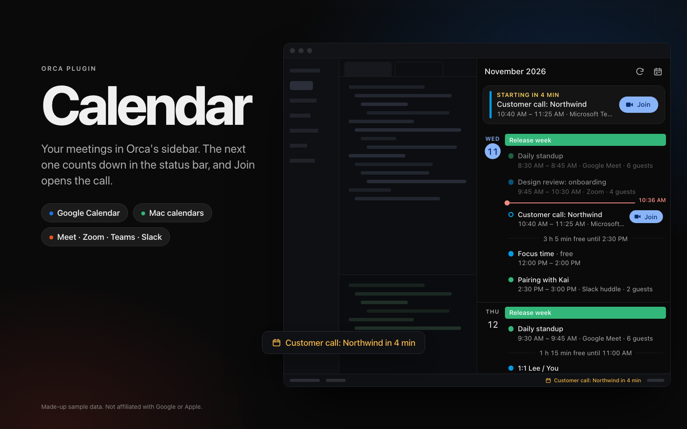
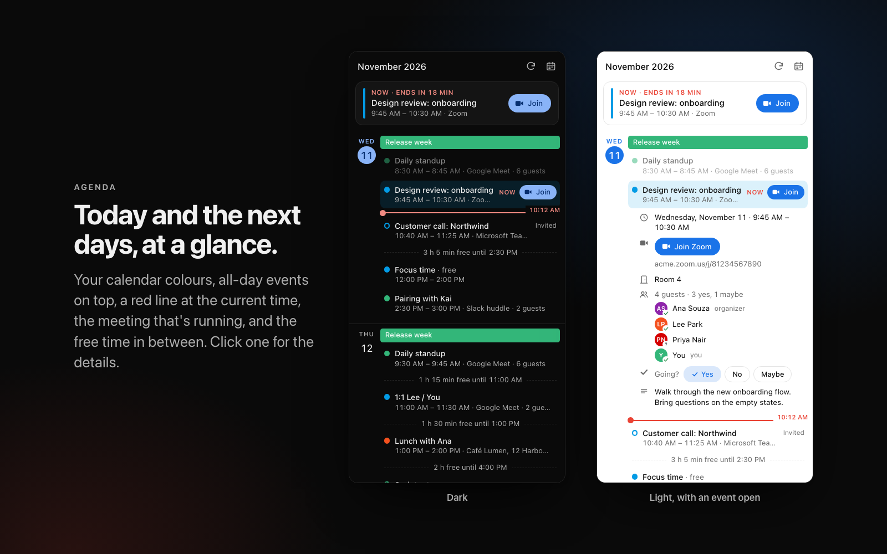
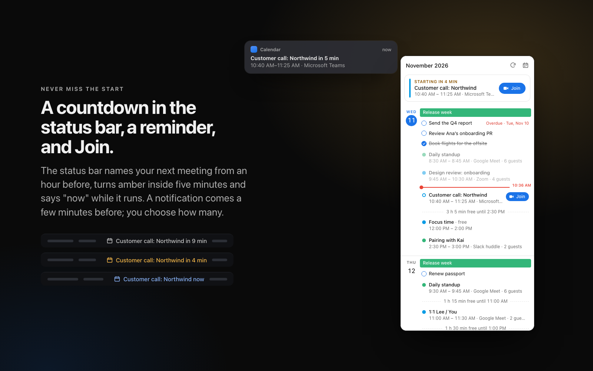
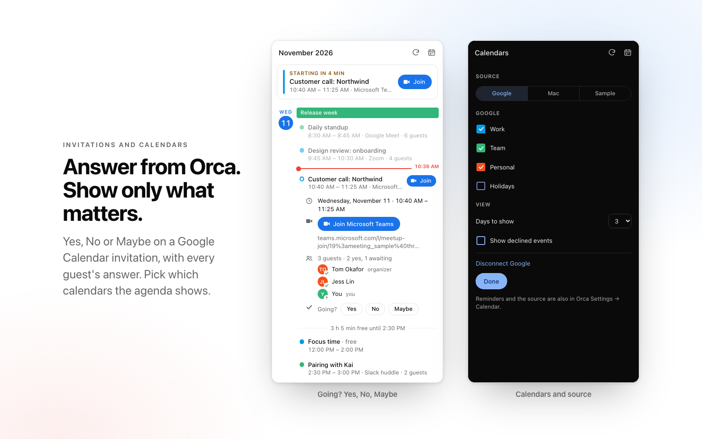
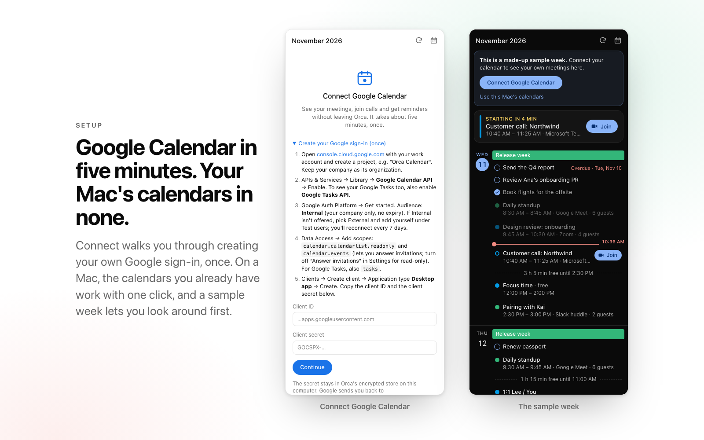

# Calendar for Orca

Your meetings in Orca's sidebar, so the next one is never a browser tab away.

**[Open in Orca →](https://onorca.dev/plugins/bautistapessagno.calendar)** &nbsp;·&nbsp;
share link: `orca://plugins/bautistapessagno.calendar?catalog=community`

- **Agenda** for today and the next days, in the style of Google Calendar's schedule view: your
  calendar colours, all-day events on top, a red line at the current time, the meeting that's
  running highlighted, and your free time between meetings.
- **Up next**, at the top of the panel and in Orca's status bar: "Standup in 12 min", amber
  inside five minutes, "now" while it runs, hidden when nothing is coming up within the hour.
- **Join** Google Meet, Zoom, Microsoft Teams and Slack huddle calls with one click.
- **A reminder** a few minutes before each meeting, as a desktop notification.
- **Answer invitations**: Yes, No or Maybe on a Google Calendar invitation, from the panel.
- **Google Tasks** on the day they're due, overdue ones on today, with a checkbox to tick them off.
- **Pick your calendars**, see declined events if you want them, and choose how many days to show.

Not affiliated with Google or Apple.



| | |
| --- | --- |
|  |  |
|  |  |

The images show the made-up sample week. `node scripts/render-listing-images.mjs` renders them again from the real panel.

## Install

Needs Orca 1.4.248 or newer.

1. Open [the plugin's page](https://onorca.dev/plugins/bautistapessagno.calendar) and click
   **Open in Orca**, or in Orca: Settings → Plugins → search **Calendar** in the community
   catalog. By hand: **Install plugin** → Git URL →
   `https://github.com/BautistaPessagno/orca-calendar#v0.2.1`.
2. Full-access plugins need Orca's separate setting that allows them (off by default).
3. Review what it asks for and click **Enable**. It asks for notifications (meeting reminders),
   its own settings, its own storage and its own encrypted secrets (the Google login).

## Where your meetings come from

| Source | Setup | What you get |
| --- | --- | --- |
| **Google Calendar** (recommended) | About five minutes, once | Your Google colours, every meeting link Google knows, your answer to each invitation, works on any computer |
| **Mac calendars** | None: allow access once | Every account in System Settings → Internet Accounts (Google, Exchange, iCloud). Meeting links found in the location and notes. macOS only |
| **Sample week** | None | A made-up week to try the panel |

With the source on **Auto** (the default), Calendar uses Google Calendar once you've connected it,
and your Mac's calendars until then.

## Connect Google Calendar

Google only lets an app read your calendar through an OAuth client that belongs to someone. The
simplest, and the one your company's admin is most likely to allow, is your own, in a Google
Cloud project of your company. You create it once.

1. Open [console.cloud.google.com](https://console.cloud.google.com/projectcreate) signed in with
   your work account, and create a project (for example "Orca Calendar"). Leave your company as
   its organization.
2. **APIs & Services → Library**, search **Google Calendar API**, press **Enable**.
3. **Google Auth Platform → Get started** (it may say **OAuth consent screen**). App name: anything,
   for example "Orca Calendar". Audience: **Internal**. Internal means only people in your company
   can sign in, Google doesn't review it, and the login doesn't expire.
   - If **Internal** isn't offered (a personal Gmail account, or a project outside your company's
     organization), pick **External**, then under **Audience → Test users** add your own address.
     Google ends a test user's login after 7 days, so you'll press Connect again once a week.
4. **Data Access → Add or remove scopes**, and add:
   - `https://www.googleapis.com/auth/calendar.calendarlist.readonly`
   - `https://www.googleapis.com/auth/calendar.events`, so you can answer invitations from Orca.
     For a read-only login, add `https://www.googleapis.com/auth/calendar.events.readonly` instead
     and turn off **Answer invitations** in Orca Settings → Calendar.
5. **Clients → Create client**. Application type: **Desktop app**. Name: anything. Press
   **Create**, then copy the **Client ID** and the **Client secret**.
6. In Orca, open the Calendar panel and press **Connect Google Calendar**: it's on the sample
   week's card and at the bottom of the agenda (or pick **Google** under Source in the calendar
   menu). Paste the client ID and the secret, press **Continue**, then **Sign in with Google**. Your browser opens
   Google's sign-in. Allow access, and go back to Orca.

Calendar keeps the client secret and your login in Orca's encrypted store on this computer. They
are never sent anywhere but Google. Google sends your browser back to
`http://127.0.0.1:43119/callback`, which only this computer can reach. If something else uses
port 43119, change **Login port** in Orca Settings → Calendar.

### If your company blocks it

Google Workspace admins can stop employees from signing in to apps they haven't approved.

- **"Access blocked: … has not been approved by your admin"** or **admin_policy_enforced**: ask
  your admin to go to **Admin console → Security → Access and data control → API controls →
  Manage third-party app access**, add the app by its **client ID**, and mark it **Trusted**.
  Read-only permissions don't get around this: admins restrict by service (Calendar), not by
  permission.
- **You can't create a project in your company's organization**: ask your admin for a project,
  or for permission to create one. A project outside the organization can't be Internal.
- Until then, the **Mac calendars** source shows the same meetings if your work account is added
  to macOS.

### Disconnect

Calendar menu → **Disconnect Google**. Calendar asks Google to revoke the login and forgets it.
You can also remove access at [myaccount.google.com/permissions](https://myaccount.google.com/permissions).

## Answer invitations

Open an invitation in the agenda and press **Yes**, **No** or **Maybe** next to "Going?". Calendar
changes only your own answer, on that one occurrence of a repeating meeting, and Google emails
the organizer as it does when you answer in Google Calendar. Nothing is sent until you press.

This needs Google Calendar as the source (macOS doesn't let apps answer invitations) and a login
that allowed Calendar to change your events. If you connected before turning it on, the panel
offers **Connect Google again**. Turn off **Answer invitations** in Orca Settings → Calendar to
keep the login read-only.

## Google Tasks

With Google Calendar as the source, your Google Tasks show in the agenda on the day they're due,
under the all-day events. Unfinished tasks from earlier days lead today, marked overdue. Tick the
circle to mark a task done in Google, or tick it again to undo. Google's Tasks API has no time of
day, only a date, so tasks never count for the status bar or reminders.

Tasks are optional. Connect asks for them along with your calendar, and you can untick them on
Google's screen. Without them, or without the API turned on, the agenda shows your calendar exactly
as before. To add them:

1. In your Google Cloud project: **APIs & Services → Library → Google Tasks API → Enable**.
2. Under **Data Access**, add `https://www.googleapis.com/auth/tasks` (or `tasks.readonly`, see
   below).
3. In Orca, open the calendar menu: under **Tasks**, press **Show Google Tasks: connect Google
   again**.

The calendar menu also hides or shows each task list. Turn off **Tick off tasks** in Orca
Settings → Calendar to keep the Tasks login read-only; it takes effect when you connect again.

## Mac calendars

Pick **Mac** in the panel's calendar menu (or leave the source on Auto), then press **Allow
access**. macOS asks once whether Orca may read your calendars. If you said no, turn Orca on
under **System Settings → Privacy & Security → Calendars**, then press **Try again**.

## Settings

Orca Settings → Calendar:

| Setting | Default | |
| --- | --- | --- |
| Calendar source | Auto | Auto, Google Calendar, Mac calendars, or the sample week |
| Days to show | 3 | 1 to 14 |
| Remind me before meetings | On | A desktop notification for each meeting you haven't declined |
| Minutes before | 5 | 0 shows it as the meeting starts |
| Show declined events | Off | Shown struck through; they never count for the status bar or reminders |
| Answer invitations | On | Yes / No / Maybe on Google invitations; off keeps the Google login read-only |
| Tick off tasks | On | A checkbox on Google Tasks; off keeps the Tasks login read-only |
| Google OAuth client ID | | Filled in by the panel |
| Login port | 43119 | Where Google sends you back after signing in |

The panel's calendar menu also picks which calendars to show; it starts with the ones your
Google Calendar shows.

## What counts as a meeting

The status bar and reminders count timed events you haven't declined, on calendars you show,
that you're busy for. All-day events and events marked "Free" (focus time, for example) are
shown in the agenda but never counted. When two meetings are back to back, the status bar moves
to the next one five minutes before it starts.

## Privacy

Calendar reads your events and tasks to show them. It never creates, edits or deletes an event; it
changes only your answer to an invitation, when you press Yes, No or Maybe, and whether a task is
done, when you tick it. The worker
fetches from Google (or reads your Mac's calendar store) on this computer and keeps the agenda
in memory. It stores which calendars you hid and which meetings it already reminded you of, in
Orca's storage for the plugin. The join button only opens https links to Google Meet, Zoom,
Microsoft Teams and Slack, or the call link in Google's own meeting data, and Orca asks you
before it opens a site for the first time.

## Access it asks Orca for

- Run its own code (a worker) on this computer: to reach Google and your Mac's calendars.
- Show desktop notifications: the reminders.
- Its own settings, storage and encrypted secrets.

## Development

Plain ES modules with no build step and no npm dependencies.

```sh
node --test                          # or: orca plugin test .
orca plugin validate .
orca plugin check .
orca plugin dev watch . --check --shot .orca/shots
node scripts/render-shots.mjs        # every panel state, light and dark, from the sample week
node scripts/render-listing-images.mjs  # the plugin page's cover, screenshots and icon, into images/
```

- `worker.mjs`: the worker entry: panel requests, the status bar, reminders.
- `src/service.mjs`: which backend, which calendars, the last agenda read.
- `backends/google/`: OAuth (PKCE, loopback), the API client, the event normalizer, `tasks.mjs` for Google Tasks.
- `backends/eventkit/`: `eventkit.js` runs under `osascript -l JavaScript`; `backend.mjs` wraps it.
- `backends/sample.mjs`: the made-up week.
- `shared/`: the agenda, join links and time formatting, used by both the worker and the panel.
- `panel/index.html`: the sidebar panel.
- `docs/research/calendar-backends.md`, `docs/specs/calendar/spec.md`, `docs/specs/tasks/spec.md`: why it's built this way.

## License

MIT
