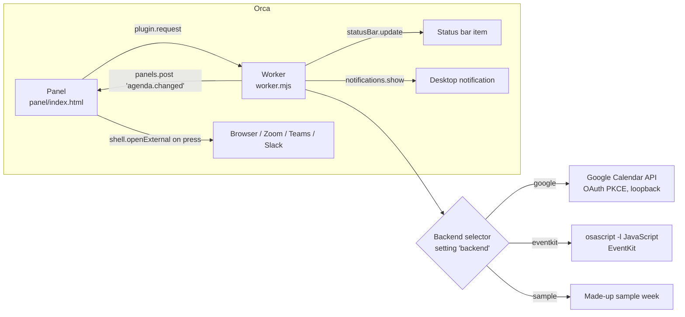
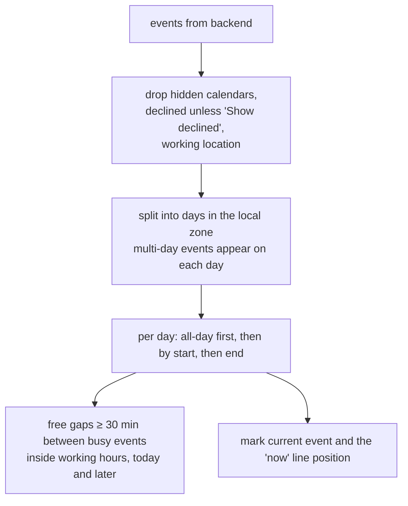
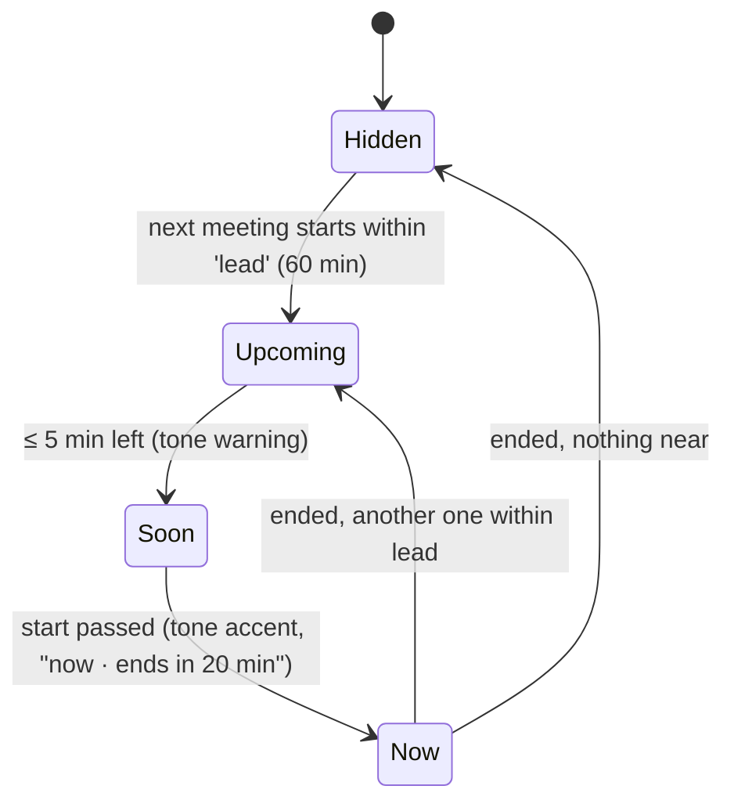

Artifact: https://claude.ai/artifact/SBrzKfMzEstLwHMMMyHTX2

# Calendar for Orca

## Problem

The user works inside Orca all day and misses meetings or loses track of what is next. Their
calendar is Google Calendar on a company Google Workspace account. Switching to a browser tab to
check it is the step that gets skipped.

## Solution

An Orca plugin, `calendar`, with:

- a sidebar panel: an agenda for today and the next days in Google Calendar's schedule-view
  style on Orca's theme;
- a status bar item: the next meeting with a countdown, a warning tone inside five minutes,
  "now" while it runs, hidden when nothing is near;
- a join button for Google Meet, Zoom, Teams and Slack huddle links;
- a desktop notification a set number of minutes before each meeting;
- a calendar picker;
- Accept / Maybe / Decline on invitations (Google only, stage 2).

Research and the backend choice: [`docs/research/calendar-backends.md`](../../research/calendar-backends.md).



### Backends

One interface, like Now Playing's:

```text
Backend {
  id            'google' | 'eventkit' | 'sample'
  capabilities  { rsvp: boolean, conference: boolean }
  calendars()   → Calendar[]        { id, title, color, account, primary }
  events({ from, to, calendarIds }) → Event[]
  respond(event, 'accepted' | 'tentative' | 'declined')   // rsvp only
  status()      → { state: 'ready' | 'needs-setup' | 'unauthenticated' | 'no-access' | 'unsupported', message? }
}
```

The `auto` setting picks Google when a client ID and a login exist, else EventKit on macOS,
else asks the user to connect Google. `sample` shows a made-up week; it exists so a person can
try the panel, and so screenshots never contain real events.

### The normalized event

```text
Event {
  id, calendarId, title, color,                 // color: the event's own, else the calendar's
  allDay: boolean,
  start, end: epoch ms (timed) | 'yyyy-mm-dd' (all-day; end exclusive),
  location?, description? (plain text, ≤ 2 kB),
  conference?: { kind: 'meet' | 'zoom' | 'teams' | 'slack' | 'other', url, label },
  attendees: { name, email?, response, self, organizer, optional, resource }[],
  attendeesOmitted?: boolean,
  self?: { response: 'accepted' | 'tentative' | 'declined' | 'needsAction' | null },
  status: 'confirmed' | 'tentative',
  busy: boolean,                                // transparency / availability
  recurring: boolean,
  kind: 'default' | 'focusTime' | 'outOfOffice',
  htmlLink?
}
```

Times stay epoch ms from the worker to the panel. The panel formats them with `Intl` in Orca's
own time zone; all-day dates never pass through a time zone.

### Agenda (pure, `panel/agenda.mjs`, shared by panel and worker)



### Status bar



Which meetings count: timed, not declined, not "free", not cancelled. All-day events never.
Text: `Standup in 12 min`, `Standup in 1 h 5 min`, `Standup now`. The worker computes the next
moment the text changes and sets one timer for it (the next whole minute while counting, or the
next start/end); it never re-reads the calendar for this. The agenda refreshes every 5 minutes
(Google) or 2 minutes (EventKit), and on every panel request.

The item has no command: a worker cannot open URLs (`shell.openExternal` is panel-only) or open
a plugin panel. Its tooltip names the meeting, its time and where it happens.

### Notifications

Setting `notify` (boolean, default on) and `notifyMinutes` (integer, 0–60, default 5). For each
counted meeting, one notification at `start − notifyMinutes`: "Standup in 5 min" with the
location or conference kind. Each (event id, start) is notified once; the set is kept in
`orca.storage` so a worker restart does not repeat one.

### Join links

`src/links.mjs`, in order: Google `conferenceData` video entry point, `hangoutLink`, then the
first match in location, URL and description:

| Kind | Pattern (https only) |
| --- | --- |
| meet | `meet.google.com/<abc-defg-hij>` |
| zoom | `<sub>.zoom.us/j/<digits>`, `/my/<name>`, `zoomgov.com/j/…` |
| teams | `teams.microsoft.com/l/meetup-join/…`, `teams.live.com/meet/…` |
| slack | `app.slack.com/huddle/<T…>/<C…>`, `<ws>.slack.com/huddle/…` |

The panel opens the URL with `orca.shell.openExternal` on a press, and re-checks it against the
same patterns before opening.

### Panel

Google Calendar's schedule view on Orca's theme variables:

```text
┌──────────────────────────────────────┐
│ Today · Tue 11 Nov        ⟳  ⚙       │ header, calendar picker behind ⚙
│ ┌──┐                                 │
│ │11│ ▌Company offsite (all day)      │ all-day chips first
│ │TUE ▌09:30–09:45 Standup   [Join]  │ colour bar, time, title
│ └──┘    Meet · 6 guests · ✓ going    │ second line: where, who, your answer
│  ●───────────────────────── 10:12    │ red "now" line
│      ▌10:00–11:00 Design review  now │ current event highlighted
│      ┄ free 11:00–13:00 ┄            │ free gap
│ 12 WED ▌…                            │
└──────────────────────────────────────┘
```

Click an event to expand: full time with time zone, location, conference, organizer, attendees
with their answers, notes, and (stage 2) Accept / Maybe / Decline. States: loading, needs setup
(connect screen with the Google steps and a "Use Mac calendars" link), Mac access needed, denied,
error, empty day, nothing in N days.

### Settings

| key | type | default |
| --- | --- | --- |
| `backend` | `auto` \| `google` \| `eventkit` \| `sample` | `auto` |
| `clientId` | string | — |
| `redirectPort` | integer | 43119 |
| `days` | integer 1–14 | 3 |
| `notify` | boolean | true |
| `notifyMinutes` | integer 0–60 | 5 |
| `showDeclined` | boolean | false |
| `rsvp` (stage 2) | boolean | true |

Secrets: `google.clientSecret`, `google.tokens`. Storage: `hiddenCalendars`, `notified`.
Capabilities: `settings:own`, `secrets:own`, `storage:own`, `notifications:show`.

### Worker protocol

```text
agenda.get       { days? }            → { backend, status, calendars, events, fetchedAt, capabilities }
agenda.refresh                        → same, re-read now
calendars.set    { hidden: string[] } → agenda
backend.select   { backend }          → agenda
auth.start       { clientId, clientSecret } → { url }
auth.status                           → { status: 'idle'|'pending'|'connected'|'failed', message? }
auth.disconnect                       → { ok }
eventkit.request                      → status after the macOS prompt
event.respond    { id, calendarId, response }  → agenda (stage 2)
post: 'agenda.changed'  agenda
```

## Stages

1. **PR 1**: research, spec, backends (Google read-only, EventKit, sample), agenda, status bar,
   notifications, join links, panel, README.
2. **PR 2** (stacked): Accept / Maybe / Decline for Google, the `rsvp` setting and its scope.

## Testing

`node --test` with injected fakes: a fake Google API (`fetch` stand-in), a fake `osascript`
runner, a fake clock and timers, fake host. No test touches a real account; the write path is
tested only against the fake API. Screenshots use the sample backend.

## Out of scope

Creating or editing events, iCal URLs, Outlook's own API, a week grid.
