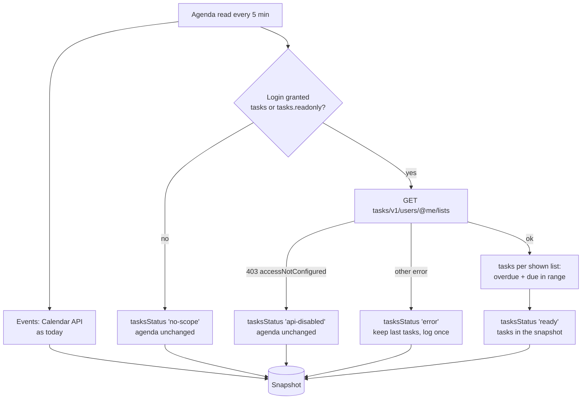
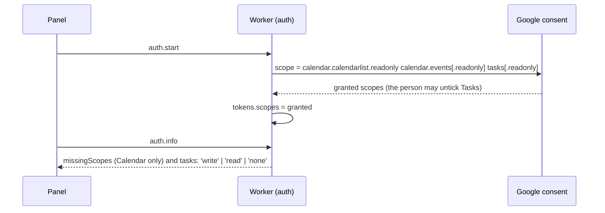

Artifact: https://claude.ai/artifact/TY1ASF3mqJQwgzvzY8wFne

# Google Tasks in Calendar

## Problem

Google Calendar shows your Google Tasks next to your meetings. Orca's Calendar shows only events,
so a task due today is invisible from the sidebar. The Calendar API never returns tasks: they live
behind a separate API (Google Tasks API v1) with its own permission and its own switch in the
Google Cloud project. Not everyone will turn that on, and nobody's calendar may break because of
it.

## Solution

Tasks are **additive**. The Google login asks for a Tasks permission next to the Calendar ones, as
an optional extra. When the login has it and the Tasks API is enabled in the person's Cloud
project, the agenda shows each task on the day it's due, with a checkbox that marks it done in
Google. When either is missing, the agenda looks exactly as it does today: no error, no banner,
no "connect again". The calendar picker is the only place that says what's missing and how to
add it.



A failure on the tasks side never changes `status`, `message` or `events`. Only the event read
decides those, as before. Three more guards keep it that way:

- The Tasks client never ends the Google login: a second 401 from the Tasks API becomes a tasks
  error (`createClient({ endsLogin: false })`), where the Calendar client would sign out.
- The snapshot waits for tasks at most 5 s after the events are in; past that the last tasks stay,
  with `tasksStatus 'error'` ("Google Tasks is slow to answer").
- When the event read fails without a setup state (offline, rate limited), the last tasks stay.

### Login: optional scopes



- `scopesFor({ rsvp })` stays the required set; `missingScopes` keeps checking only it, so a login
  without Tasks is never "missing" anything.
- `optionalScopesFor({ completeTasks })`: `tasks` when the `completeTasks` setting is on (default),
  `tasks.readonly` when off. Every Connect asks for required plus optional.
- `connection()` adds `tasks`: `'write'` if `tasks` was granted, `'read'` if only `tasks.readonly`,
  else `'none'`. `tasks` covers `tasks.readonly`.
- Logins made before this change have no Tasks scope. They keep working; the picker offers
  **Show Google Tasks**, which runs the same Connect again.

### Reading tasks

`backends/google/tasks.mjs`, over the same client with base `https://tasks.googleapis.com/tasks/v1`:

1. `GET /users/@me/lists?maxResults=100`: the task lists (up to 5 pages).
2. For each shown list, two reads (up to 5 pages of 100 each, so at most 500 tasks per read):
   - overdue: `dueMax=<today>T00:00:00Z`, `showCompleted=false`, `showAssigned=true`;
   - in range: `dueMin=<today>T00:00:00Z`, `dueMax=<today + days>T00:00:00Z`,
     `showCompleted=true`, `showHidden=true` (tasks ticked in Google's own apps are hidden
     otherwise), `showAssigned=true`.
3. Tasks with no `due` are left out: Google Calendar doesn't show them either. So is a `due` that
   isn't a real day.
4. A task returned by both reads (Google doesn't say whether `dueMax` is inclusive) counts once.
5. A list that fails is left out and named: `tasksStatus 'error'`, "Couldn't read the task list
   “Errands”", while the other lists show. Every list failing is a tasks error like any other.

`due` carries only a date: Google stores it as midnight UTC and the API can't read the time a
task was given in Calendar. So the date is `due.slice(0, 10)`, never converted between time zones,
and a task never counts for the status bar or the reminders.

```text
Task {
  id, listId, listTitle,
  title,                      // '(No title)' when empty, ≤ 300 chars
  notes,                      // plain text ≤ 2 kB, or null
  due: 'yyyy-mm-dd',
  done: boolean,
  completedAt: epoch ms | null,
  parentId: string | null,    // subtasks show flat, like Google Calendar
  assigned: boolean,          // from Docs or Chat
  link: https URL | null      // webViewLink
}
```

### Ticking a task done

`PATCH /lists/{list}/tasks/{task}` with `{ status: 'completed' }`, or
`{ status: 'needsAction', completed: null }` to undo. Only on a press in the panel, only when the
login has `tasks` and `completeTasks` is on. The panel shows the tick at once; the worker returns
the snapshot with the task changed and then reads again.

### Agenda

`buildAgenda(events, { tasks, … })` adds `day.tasks`:

- each day: tasks due that day, not done first, then done (struck through), each by title;
- today, before them: tasks not done and due before today, oldest first, marked overdue.

A day with tasks and no events says nothing about being empty.

```text
┌──────────────────────────────────────┐
│ 11 ▌Company offsite                  │ all-day chips
│ TUE ○ Send the Q4 report  overdue·Mon│ overdue, on today only
│     ○ Review Ana's PR                │ due today
│     ● ̶B̶o̶o̶k̶ ̶f̶l̶i̶g̶h̶t̶s̶                    │ done, struck through
│  ●──────────────────────── 10:12     │
│     ▌10:00–11:00 Design review       │
└──────────────────────────────────────┘
```

Clicking a task's title opens its notes, its list, and **Open in Google Tasks**
(`https://tasks.google.com/` links only).

### Calendar picker

A **Tasks** section under the calendars:

| tasksStatus | Shows |
| --- | --- |
| `ready` | a checkbox per task list (stored as `<backend>:tasks:<list id>` in `calendars`) |
| `no-scope` | "See your Google Tasks next to your meetings." and **Show Google Tasks: connect Google again** |
| `api-disabled` | "Turn on the Google Tasks API in your Cloud project" with a link to it |
| `error` | the message, and the last tasks stay in the agenda |
| `off` | nothing (Mac calendars, before connecting) |

The sample week has two lists and a few tasks, one overdue and one done, so the panel and the
screenshots show them.

### Settings

| key | type | default | |
| --- | --- | --- | --- |
| `completeTasks` | boolean | true | Checkbox on tasks; off asks for `tasks.readonly`. Takes effect at the next Connect. |

### Worker protocol

```text
agenda.get     → Snapshot + { tasks: Task[], taskLists: { id, title, shown }[], tasksStatus, tasksMessage? }
                 capabilities.completeTasks: login has 'tasks' and the setting is on
tasks.lists.set  { id, shown }                → Snapshot
task.complete    { id, listId, done }         → Snapshot
auth.info      → + tasks: 'write' | 'read' | 'none', completeTasks (the setting, for the setup help)
```

## Stages

One PR: scopes, tasks reader, service, agenda, panel, sample tasks, setting, README, tests.

## Testing

`node --test` with the fake Google (`tasks.googleapis.com` routes): granted / not granted / API
disabled / one list failing / paging / overdue and range queries / PATCH body for done and undo.
Service: a tasks failure leaves `status` and `events` untouched. Agenda: overdue on today only,
done after not done, date-only `due` across time zones. Panel (headless Chrome): checkbox sends
`task.complete`; no Tasks section noise on the agenda when `no-scope`.

## Out of scope

Creating or editing tasks, task times (the API has none), tasks on Mac calendars (Reminders).
